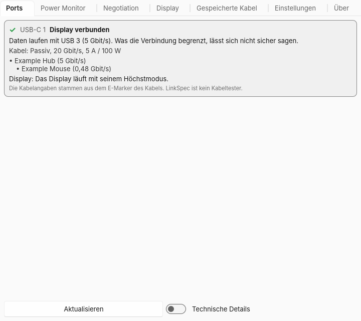

# LinkSpec

**Deutsch** · [English](#english)

LinkSpec zeigt für jeden USB-C-, Thunderbolt- und USB4-Port, was anliegt und
**welches Glied die Verbindung begrenzt: Port, Kabel, Ladegerät oder
Endgerät** – in einem verständlichen Satz. Für Windows 11, Linux und macOS
(Apple Silicon). Als Tray-/Menüleisten-App und als Kommandozeile mit JSON.

> **LinkSpec ist kein Kabeltester.** Software sieht nur, was die
> Port-Controller und die E-Marker der Kabel melden. E-Marker können falsche
> Angaben machen. Details: [docs/grenzen.md](docs/grenzen.md).



## Was LinkSpec beantwortet

- *Warum lädt mein Laptop langsam?* → Kabel, Netzteil oder Rechner.
- *Warum ist die Platte oder das Display langsam?* → Port, Kabel oder
  Endgerät. Ist das Gerät selbst am Limit, spricht LinkSpec das Kabel frei.
- *Was kann dieses Kabel laut E-Marker?* → Tempo, Strom, Typ, Hersteller,
  Zertifizierungsstatus – ohne Netz.
- *Die Verbindung reißt ab.* → Banner und Eintrag in der Kabel-Historie.

## Installation

| Plattform | Weg |
|---|---|
| Windows | MSI aus den [Releases](https://github.com/itsh-neumeier/linkspec/releases) (Dienst optional), `winget install LinkSpec.LinkSpec`, Scoop |
| macOS | `.dmg` aus den Releases, `brew install --cask linkspec` |
| Linux | `.deb`, `.rpm`, AppImage, Tarball, AUR `linkspec-bin` |
| Rust | `cargo install linkspec-cli` |

Paketquellen und Signierung bereitet der Maintainer vor
([docs/MAINTAINER_TODO.md](docs/MAINTAINER_TODO.md)).

## Kommandozeile

```text
linkspec                    Kurztext, ein Block pro Port (✓ / ! / ✗)
linkspec --json             JSON nach Schema linkspec.diagnose.v1
linkspec --watch [--json]   bei jeder Änderung neu (NDJSON mit --json)
linkspec --raw              zusätzlich Rohwerte und Belege
linkspec --no-usb-probe     ohne aktive USB-Abfragen
linkspec --monitor[-json]   Live-Leistung
linkspec --dashboard        Vollbild-TUI (Tab wechselt, q beendet)
linkspec --report           vorausgefülltes Issue „Kabel melden“ im Browser
linkspec --capture          anonymisierter Capture für Fehlerberichte
linkspec --lang de|en       Sprache erzwingen
linkspec --tray | --window  App starten
```

Exit-Codes: `0` Diagnose erstellt, `2` Aufruffehler, `3` Plattform nicht
unterstützt bzw. Datenquelle nicht lesbar. Beispiel:

```text
! USB-C 1 — Nur Laden
  Das Kabel begrenzt die Leistung auf 60 W. Netzteil und Rechner könnten 100 W.
  Kabel: Passiv, 20 Gbit/s, 3 A / 60 W
  Laden: Vertrag: 60 W (20 V / 3 A)
```

## Datenschutz

Komplett offline. Keine Telemetrie. Einziger automatischer Netzzugriff: die
abschaltbare Update-Prüfung der App (höchstens alle 6 Stunden, ohne
Hardwaredaten). Siehe [docs/datenschutz.md](docs/datenschutz.md).

## Spezifikationsstand

Decoder auf **USB Power Delivery R3.2** (PDOs inkl. SPR/EPR AVS, Discover
Identity, Kabel-VDOs) und **UCSI 2.x/3.0** ausgerichtet; ältere Versionen
werden toleriert, unbekannte Bits ignoriert. Was jede Plattform liefert, steht
in der [Fähigkeitsmatrix](docs/capability-matrix.md).

## Entwicklung

Regeln und Befehle: [AGENTS.md](AGENTS.md). Fortschritt:
[docs/PROGRESS.md](docs/PROGRESS.md). Architektur: [docs/adr/](docs/adr/).

Inspiriert vom Verhalten des macOS-Werkzeugs WhatCable; LinkSpec ist eine
eigenständige Neuentwicklung ohne fremden Code.

Lizenz: MIT. Drittlizenzen: [THIRD_PARTY_LICENSES](THIRD_PARTY_LICENSES).

---

<a id="english"></a>

## English

LinkSpec tells you, for every USB-C, Thunderbolt and USB4 port, what is
connected and **which link limits the connection: port, cable, charger or
device** – in one plain sentence. For Windows 11, Linux and macOS (Apple
silicon), as a tray/menu bar app and as a command line tool with JSON output.

> **LinkSpec is not a cable tester.** Software only sees what the port
> controllers and the cables' E-Markers report. E-Markers can report wrong
> values.

- *Why is my laptop charging slowly?* → cable, charger or computer.
- *Why is my drive or display slow?* → port, cable or device; if the device
  itself is at its limit, LinkSpec says so and clears the cable.
- *What can this cable do according to its E-Marker?* → speed, current, type,
  vendor, certification status – offline.
- *The connection keeps dropping.* → banner and cable history entry.

Install: MSI/winget/Scoop (Windows), DMG/Homebrew (macOS), deb/rpm/AppImage/
tarball/AUR (Linux), or `cargo install linkspec-cli`. CLI usage as above
(`--json` follows the schema `linkspec.diagnose.v1`; exit code 3 means the
platform or data source is not supported).

Privacy: fully offline, no telemetry; the only automatic network access is
the app's update check (at most every 6 hours, no hardware data, can be
turned off). Spec level: USB PD R3.2, UCSI 2.x/3.0.

Inspired by the behaviour of the macOS tool WhatCable; LinkSpec is an
independent implementation. License: MIT.
